# Rainfall Timing and Rice Yield in India: Critical Pre-Harvest Exposure Windows and the Limits of Weekly Lags for Forecasting

**Authors:** Sankar S. Pillai, Martin Wills
**Project:** *Rainfall-Lag-Aware Crop Yield Forecasting in India Using Explainable Temporal Machine Learning*
**Status:** complete study; every number in this paper is produced by code in this repository (`notebooks/06-11`, `results/tables`).

---

## Abstract

**Background.** Crop-yield models usually describe rainfall by seasonal totals, which cannot tell a well-distributed monsoon from one that delivers the same volume in bursts. **Question.** Does the *timing* of rainfall in the 16 weeks before harvest explain and improve district-level rice yield forecasts in India? **Data.** 10,279 district-years (384 districts, 1990-2017); the supplied dataset has only seasonal aggregates, so we built the missing time-resolved weather from IMD 0.25° daily rainfall, validated against the dataset's own rainfall column (r = 0.905), with zero-look-ahead lags anchored to zone-specific harvest weeks.
**Methods.** Chronological split (train 1990-2009, validation 2010-2013, test 2014-2017); nine rainfall representations x three forecasting formulations x Ridge/RF/XGBoost/LSTM/GRU, five seeds, district-cluster paired bootstrap, shuffled-week and placebo-window controls, rolling-origin evaluation, and a panel fixed-effects distributed-lag regression with SHAP/permutation importance.

**Findings.**
1. **Rainfall timing is a real, structured driver of yield.** The 16 weekly effects are jointly significant (p = 1.6x10^-16) and unequal (p = 3.1x10^-8). Rain in the **final two weeks before harvest** raises yield by 3-5 % per +100 mm (week -1: +5.0 %, 95 % CI 2.9-7.1), with further effects at **panicle initiation** (weeks -7, -5) and **transplanting** (weeks -13, -16); weeks -3, -4, -10, -14, -15 show none.
2. **The response is asymmetric:** a 200-400 mm deficit against the district normal lowers yield by roughly 8-11 %, while surpluses give only a +2-4 % plateau, so drought, not excess, is the main risk.
3. **Calendar alignment matters:** moving the 16-week window 6 or more weeks earlier than the true pre-harvest period raises forecast error (RF 332.8 to 342.4 kg/ha at 16 weeks), validating phenology-based anchoring.
4. **Weather improves forecasts, but a seasonal anomaly captures nearly all of it.** The best weather model improves a no-weather baseline by 2.4 % (4.2 % in dry-tail years); 16 free weekly lags add no out-of-sample gain over the seasonal total (dMAE +3 to +8 kg/ha in five of six cells), order-shuffled inputs perform equally, and weather explains only 1.0-1.5 % of the yield variance left after district and year effects, which bounds any representation's forecasting gain.
5. **Structure, not resolution, makes lags useful.** In a pre-specified follow-up, parsimonious smooth distributed-lag models (3-4 parameters) recover the skill that 16 free lags lose: they are 5.8-6.3 kg/ha (RF) and 8.1 kg/ha (XGBoost) better than the free lags and slightly better than the seasonal total (RF 327.0 vs 329.0 kg/ha, -0.6 %; consistent in sign across smooth variants and model families, but only one of 21 comparisons survives Holm correction and the gain is not significant under rolling origin).
6. **The Phase 1 baseline's poor accuracy (R^2 ~ 0.13) was a non-stationarity problem, not a missing-timing problem:** test-year yields are 32 % above the training mean, and a no-weather forecast from each district's last three seasons already reaches R^2 = 0.756.
**Contribution.** A leakage-proofed, QC-validated 16-week IMD lag dataset; a controlled benchmark that separates timing from data source and formulation; an identified, confidence-interval-backed rainfall-exposure profile for rice phenology; and an operational rule: forecast with recent district yield plus one seasonal rainfall anomaly, and use week-level rainfall to analyse mechanisms (grain-filling and panicle-initiation rain), not to raise forecast accuracy.

**Keywords:** crop yield forecasting; rainfall lags; temporal leakage; explainable machine learning; LSTM/GRU; rice; India.

---

## 1. Introduction

Rice is a staple for a very large share of India's population, and district-level forecasts of its yield inform procurement, insurance and relief planning. Weather,
especially monsoon rainfall, is a dominant driver of year-to-year variation, but crops respond to *when* water arrives as well as to how much arrives:
transplanting needs standing water, panicle initiation and flowering are moisture-sensitive, and heavy rain at maturity can cause lodging. A seasonal rainfall total
discards that timing information. Our proposal therefore posited that **representing rainfall as lagged weekly exposures $R_{t-1}, \dots, R_{t-k}$ should lower forecast error and reveal critical exposure windows**.

Phase 1 of this project built a leakage-free baseline on the supplied dataset and exposed two obstacles: the dataset has no time-resolved weather (so the hypothesis could not be tested without fabricating lags, which we refused to do), and test-period performance
was poor (R² ≈ 0.13), which we attributed to the lack of timing information. This paper removes the first obstacle with real data and re-examines the second attribution; the result changes the interpretation of Phase 1.

**Research questions.**
* **RQ1** Does a 16-week lagged rainfall representation reduce forecast error relative to contemporaneous, cumulative and seasonal-aggregate representations?
* **RQ2** Which pre-harvest weeks (phenological stages) are most informative?
* **RQ3** Do conventional explainers (SHAP, permutation importance) and an explanatory panel regression agree on those windows?

**Hypotheses.** H1 lag representation lowers error; H1b the temporal *order* is exploited; H2 timing carries a structured signal; H3 the correct calendar window matters. Decision rules were fixed before inspecting verdicts (notebook 11).

**Scope changes relative to the slide proposal.** The proposal is framed around Kerala; the validated dataset covers India, so the study is India-wide. The dataset contains rice only, so the proposal's *crop-specific* lag structure is
studied as *region-specific* (irrigated vs rain-fed/mixed states, state level).

**Contributions.** (i) A real, QC-validated, leakage-proofed 16-week IMD lag dataset for 384 districts; (ii) a controlled ablation that separates *timing* from change of data source (same-source seasonal-aggregate control F1) and from forecast formulation (three tiers);
(iii) shuffled-week and placebo-window controls and rolling-origin evaluation; (iv) a triangulated explanation (TreeSHAP, permutation, panel FE); (v) a candid negative result for the predictive benefit of lags, with a variance-based explanation of why.

---

## 2. Related work

Statistical crop-climate models relate (log) yield to weather with district and year fixed effects, which isolates weather-driven variation from time-invariant productivity and common technological trends (Lobell & Burke, 2010), and exposes strongly non-linear responses
such as heat damage (Schlenker & Roberts, 2009). Machine-learning approaches - Random Forests (Breiman, 2001; Jeong et al., 2016), gradient boosting (Chen & Guestrin, 2016) and, more recently, recurrent and convolutional networks that consume within-season weather sequences (Khaki et al., 2020) - are widely reported to improve over
linear baselines; systematic reviews (van Klompenburg et al., 2020) document how often evaluations use random splits that leak future information. LSTM (Hochreiter & Schmidhuber, 1997) and GRU (Cho et al., 2014) cells are the standard recurrent architectures. For explanation, TreeSHAP (Lundberg et al., 2020) provides exact Shapley attributions for tree ensembles.
IMD's 0.25° daily gridded rainfall (Pai et al., 2014) is the standard observational rainfall product for India. The gap we address is narrow and empirical: *given the same data and splits, does week-resolved rainfall beat a seasonal total, and does the network use the week order?* (Citation details should be verified against the publishers' records before journal submission.)

---

## 3. Data

| Source | Content | Use |
|---|---|---|
| `Data.csv` (Phase 1) | 10,279 district-year records, 1990-2017, 20 states, 384 district codes: rice area/production/yield, IMD seasonal rainfall (`IMD_RF`), `IMD_Tmax`, `SD_RF_jun_nov` | target (`RICE.YIELD..Kg.per.ha.`), baseline features, state fixed effects |
| IMD gridded rainfall | daily, 0.25°, 1990-2017 | 16 weekly rainfall lags |
| IMD gridded Tmax | daily, 1° | exploratory weekly temperature lags |
| Geocoding (Open-Meteo, OSM Nominatim, alias table) | one point per district | extraction location |

Production and area are excluded from features (Yield = Production/Area; target leakage). Phase 1 chronological splits are unchanged: train 1990-2009 (n = 7,361), validation 2010-2013 (1,448), test 2014-2017 (1,470); mean yield rises from 1,793 to 2,363 kg/ha (+32 %) between train and test.

### 3.1 Constructing and validating time-resolved weather
District points were geocoded (276 Open-Meteo, 73 Nominatim, 35 resolved via a manual alias table for historical or misspelled names, e.g. "Bans Kantha" → Banaskantha). Daily weather is the mean of the 3 × 3 IMD cells around the nearest grid cell, aggregated to ISO weeks (570,240 district-weeks, none missing).

**Quality control.** The annual rainfall total extracted from the grid correlates with the dataset's own `IMD_RF` at **r = 0.905** over all 10,279 district-years (Jun-Nov total: 0.927; median per-district r = 0.917).
For districts with training-year r < 0.85 the sampling block was re-selected in the surrounding 5 × 5 neighbourhood by maximum *training-year* correlation with `IMD_RF` (74 of 384 moved; only the covariate and training years were used). Thirteen districts remain below r = 0.7 and are excluded in a sensitivity analysis.
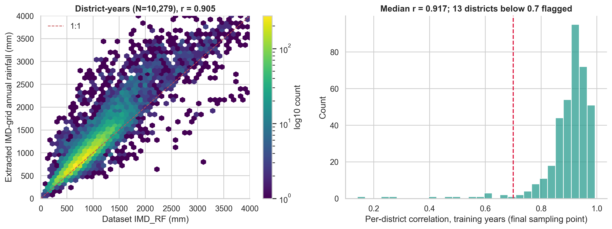

### 3.2 Crop-calendar anchoring and lag definition
Each state maps to an ICAR/DES agro-climatic zone with a Kharif harvest reference week $T_{ref}\in[41,47]$ (`src/crop_calendar.py`). For district *i*, year *y*:

$$\text{Rain\_Lag}_k^{(i,y)} = \sum_{d \in \text{ISO week } T_{ref}-k} R^{(i)}_d,\quad k=1,\dots,16.$$

**Leakage guarantees.** (i) $\max_k (T_{ref}-k)=T_{ref}-1<T_{ref}$, asserted for every row. (ii) A poisoning test replaces all weather in and after $T_{ref}$ by 10⁶ mm: no lag changes (notebook 06 §4; unit test `tests/test_weather_features.py`).
(iii) Scalers, encoders, rainfall climatologies and hyper-parameters use training (or training + validation for tuning) years only; test years are scored once per configuration.
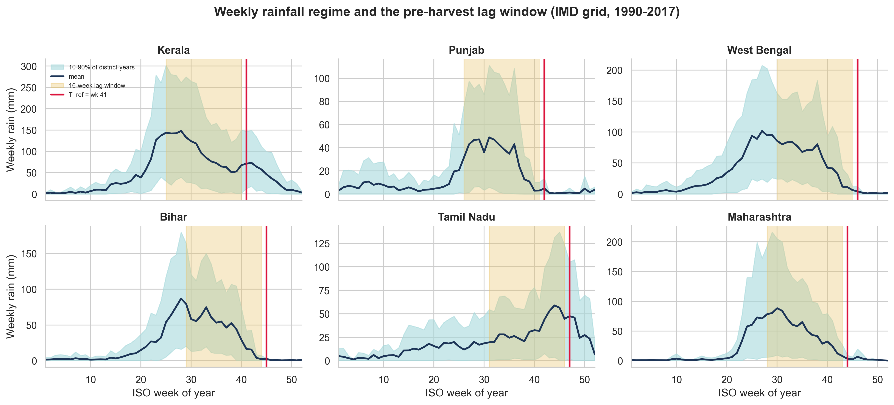

Phenology mapping of the lags (`docs/crop_calendar_reference.md`): S1 sowing/transplanting $w_{-16..-13}$; S2 tillering $w_{-12..-8}$; S3 panicle initiation $w_{-7..-4}$; S4 flowering $w_{-3,-2}$; S5 grain filling $w_{-1}$.
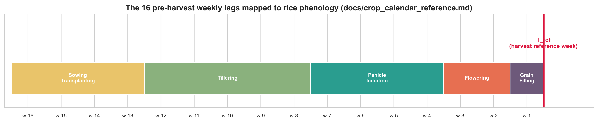

Weekly anomalies are nearly uncorrelated across weeks (mean off-diagonal r = 0.02, adjacent weeks 0.14; VIF ≤ 1.09), so the lag vector is not trivially redundant.

---

## 4. Methods

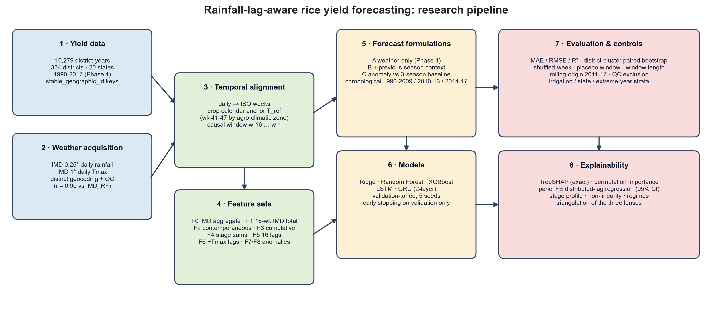

### 4.1 Rainfall representations (all with state one-hot fixed effects)

| Code | Features | Role |
|---|---|---|
| F0 | `IMD_RF`, `IMD_Tmax`, `SD_RF_jun_nov` | Phase 1 baseline (slide: $Yield_t=f(R_t,T_t)$) |
| F1 | 16-week IMD total, SD of weekly rain, `IMD_Tmax` | **same-source aggregate**: isolates timing from data-source change |
| F2 | last-4-week rain, last-week rain | contemporaneous |
| F3 | cumulative rain back 4/8/12/16 weeks | cumulative |
| F4 | 5 phenological-stage sums | stage-aware |
| F5 | 16 weekly lags | **proposed** |
| F6 | F5 + 16 weekly Tmax lags | extension |
| F7 / F8 | 16 weekly rain anomalies / total anomaly (departure from district training-year climatology) | extension |

### 4.2 Forecasting formulations
* **Tier A (weather only, Phase 1):** predict yield level from weather + state.
* **Tier B (level + context):** A + last season's district yield and the mean of the last three seasons (backward-looking; known at forecast time).
* **Tier C (anomaly):** predict $y_{it}-\bar y_{i,t-1..t-3}$, then add the baseline back. Errors are always evaluated in kg/ha of yield. Tier C removes the technology trend and district productivity level, so remaining variance is the part weather can plausibly explain.

Tier C was introduced after the pilot showed that tier A is dominated by non-stationarity (Section 5.1); it is an addition to, not a replacement of, the Phase 1 formulation.

### 4.3 Models and training
Ridge (α by validation), Random Forest (200 trees, depth ∈ {8,12,16,20}), XGBoost (250 trees; (depth, η) ∈ {(4,.05),(6,.05),(6,.03)}) with Phase 1 grids, identical for every representation; hyper-parameters chosen on validation MAE once (seed 42) and reused for five seeds.
Sequence models: 2-layer LSTM or GRU (hidden 64) on the standardised log1p weekly sequence, final hidden state concatenated with static state one-hot and `IMD_Tmax`, MLP head, AdamW (1e-3, wd 1e-4), gradient clipping 5, early stopping on validation MAE; 5 seeds (3 for controls).

### 4.4 Controls
* **Shuffled weeks:** each row's 16 values randomly permuted (aggregates preserved, timing destroyed).
* **No-weather network:** zeros as sequence input (same architecture and static inputs).
* **Placebo windows:** whole window shifted 2-16 weeks *earlier* (never later).
* **Window length:** only the last *L* ∈ {2,…,16} weeks.
* **Rolling origin:** expanding-window one-year-ahead forecasts for 2011-2017, hyper-parameters fixed.
* **Sensitivity/heterogeneity:** exclusion of 13 low-QC districts; irrigated vs rain-fed/mixed states (Punjab, Haryana, Uttar Pradesh, Andhra Pradesh, Telangana, Tamil Nadu vs the rest - a coarse external classification); dry/normal/wet tails of the 16-week anomaly.

### 4.5 Statistics
Paired differences in absolute error per district-year (seed-averaged forecasts); 95 % CI from a **district-cluster bootstrap** (4,000 draws), because the four test years of a district are dependent. $\Delta$MAE < 0 favours the first model.

### 4.6 Explanation
(1) Exact TreeSHAP of XGBoost on the test years (additivity verified to 3×10⁻³ kg/ha). (2) Permutation importance on test years (single weeks, and the 16 weeks jointly). (3) Panel regression
$\log y_{it}=\sum_k\beta_k\,\text{RainAnom}_{it,k}+\alpha_i+\gamma_t+\varepsilon_{it}$, district-clustered SEs, with Wald tests of (a) all $\beta_k=0$ and (b) all $\beta_k$ equal (timing irrelevant).

---

## 5. Results

### 5.1 Reference forecasts: what does *no weather* achieve?

| Forecast (test 2014-17) | MAE (kg/ha) | R² |
|---|---|---|
| Train-period state mean | 740.6 | 0.125 |
| Train-period district mean | 641.1 | 0.325 |
| Persistence (last year's yield) | 362.3 | 0.692 |
| **Mean of the district's last 3 seasons** | **337.2** | **0.756** |

Phase 1's weather-based models (R² 0.12-0.13, MAE 727-732) are no better than predicting each state's training mean. The Phase 2 engine reproduces them (RF 726.1, XGB 732.4 kg/ha, 5 seeds). **The large errors of Phase 1 are a level/trend problem, not a rainfall-representation problem:** mean test yield is 32 % above the training mean, and every tier-A model under-predicts the test years by +510 to +580 kg/ha on average (observed − predicted).

### 5.2 Main ablation (test MAE, kg/ha, mean ± SD over 5 seeds)

| Representation | A · RF | A · XGB | B · RF | B · XGB | C · RF | C · XGB | C · Ridge |
|---|---|---|---|---|---|---|---|
| F0 IMD aggregate | 726.1 | 732.4 | 356.3 | 351.3 | 329.4 | 332.0 | 333.2 |
| F1 same-source aggregate | 738.3 | 732.1 | 355.4 | 354.4 | 329.4 | 334.2 | 332.6 |
| F2 contemporaneous | 759.8 | 748.7 | 360.3 | 354.6 | 336.1 | 341.5 | 333.5 |
| F3 cumulative | 740.2 | 747.4 | 361.4 | 351.1 | 331.3 | 334.5 | 332.4 |
| F4 stage sums | 735.0 | 735.3 | 359.8 | 347.6 | 331.2 | 336.6 | 332.0 |
| **F5 16 weekly lags** | 742.6 | 741.1 | 368.5 | 348.0 | 332.8 | 338.1 | 334.3 |
| F6 F5 + Tmax lags | 716.6 | 697.2 | 392.1 | 355.9 | 340.8 | 346.6 | 335.5 |
| F7 anomaly lags | 714.7 | 707.0 | 365.5 | 348.9 | 332.5 | 336.7 | 332.2 |
| F8 total anomaly | 754.8 | 747.3 | 359.2 | 357.1 | **329.0** | 333.7 | 331.1 |
| *No-weather baseline* | *740.6 (state mean)* | | *362.3 (persistence)* | | *337.2* | | |

SDs over seeds are 0.2-3 kg/ha (full table `results/tables/p2_main_summary_test.csv`). 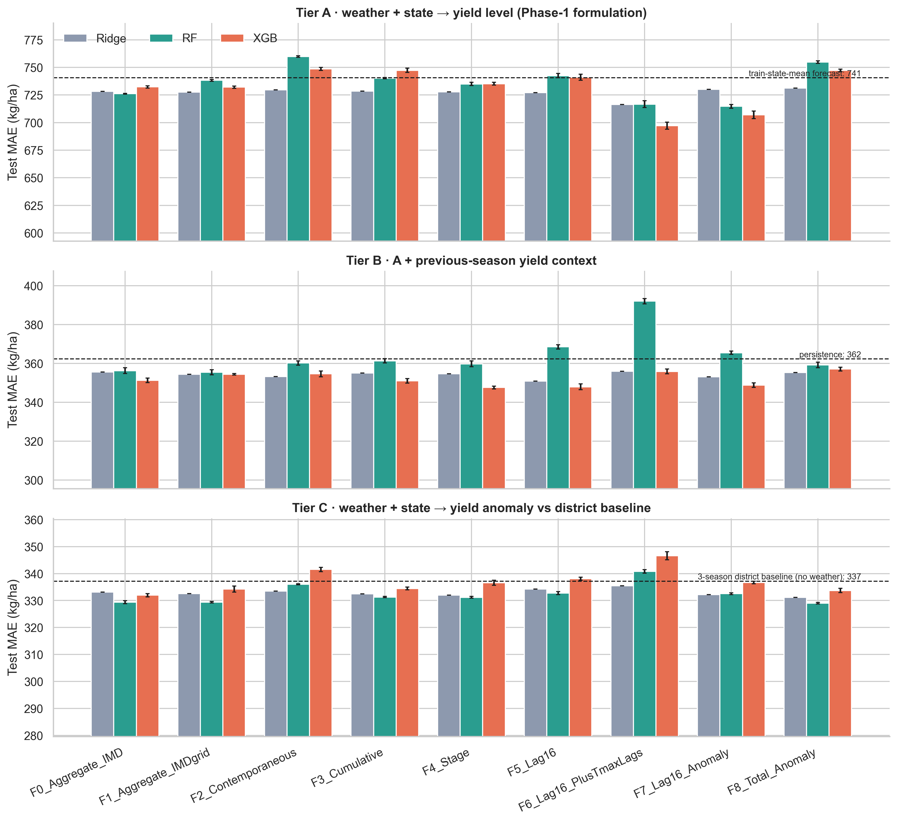

**Weather helps a little; lags do not help more.** In the tier that isolates weather (C), the best weather model (RF + seasonal-total anomaly, 329.0) improves on the no-weather baseline (337.2) by only **2.4 %**.
The proposed representation F5 is *worse* than the same-source aggregate F1 (RF +3.3 kg/ha, 95 % CI [+0.7,+5.9]; XGB +3.3 [-2.1,+8.8]; Ridge +1.7 [-0.1,+3.5]).

Paired bootstrap, F5 − F1 (negative favours lags):

| Tier | RF | XGBoost | Ridge |
|---|---|---|---|
| A weather-only | +4.2 [-10.0,+18.1] | +8.1 [-2.1,+18.7] | -0.4 [-2.5,+1.7] |
| B + context | +12.7 [+7.3,+18.8] | **-6.8 [-12.2,-1.4]** | **-3.5 [-5.7,-1.4]** |
| C anomaly | +3.3 [+0.7,+5.9] | +3.3 [-2.1,+8.8] | +1.7 [-0.1,+3.5] |

The only favourable cells are tier B with XGBoost and Ridge (≈ 1-2 % lower MAE), which RF contradicts (+3.6 %). The pattern is therefore model-dependent, not a robust gain.
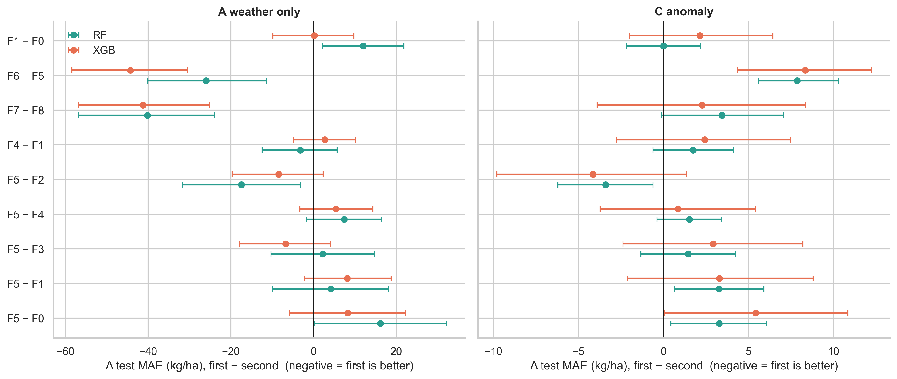

**The one consistent exception is in tier A:** variants with weekly *temperature* lags (F6) or *anomaly* lags (F7) lower MAE by 20-35 kg/ha (XGB 697-707 vs 732) and the gain is significant under rolling origin (F7 − F8 = −30 [-44,-16] RF; −39 [-53,-26] XGB). We show in 5.4 that this is most plausibly a *trend proxy*, not a rainfall-timing effect.

### 5.3 Controls: does the model use timing?

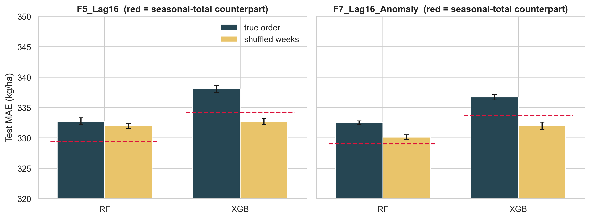

* **Shuffled weeks (tier C).** Destroying the week order did **not** increase error: F5 RF 332.7 → 332.0, F5 XGB 338.1 → 332.7, F7 RF 332.5 → 330.1, F7 XGB 336.7 → 332.0. Tree models do not use the order of the weeks; if anything, the shuffled input regularises.
* **Placebo windows.** Error rises as the window moves away from the true pre-harvest period (F5 RF 332.8 at shift 0 → 335.8 at 6 → 342.4 at 16 weeks; XGB 337.8 → 345.2 → 359.5), so **calendar alignment matters** (H3), but shifts of 2-4 weeks are indistinguishable from shift 0: the information is "weather of the right season", not week-exact timing.
* **Window length.** MAE is flat in the number of weeks used (RF 335.3 with 2 weeks, 332.8 with 16; XGB 337.8-346.2): the last few weeks suffice. 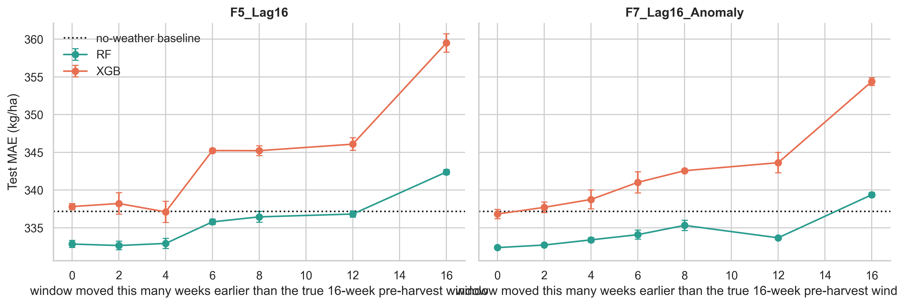
* **Rolling origin (2011-2017).** Conclusions hold in every one-year-ahead fold: tier-C F5 − F1 = +3.1 [+1.3,+4.9] (RF), +5.8 [+2.4,+9.2] (XGB). 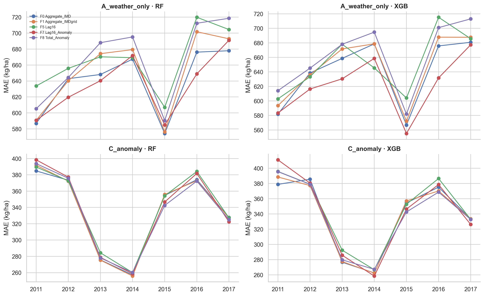
* **QC exclusion.** Dropping the 13 weakest-QC districts leaves the ranking unchanged (tier C RF: F0 329.7, F1 329.5, F5 332.7, F7 332.5, F8 329.3).

### 5.4 Heterogeneity and the temperature/trend caveat
* **Irrigated vs rain-fed/mixed (tier C, RF).** Contrary to expectation, the weather gain over the no-weather baseline is larger in predominantly irrigated states (baseline 315.2 → 294.4 with the seasonal total, −20.8 kg/ha) than in rain-fed/mixed states (348.2 → 346.9, −1.3); lags are no better than totals in either group. We do not claim a mechanism: the grouping is coarse, and irrigated-state gains may reflect cloudiness/temperature co-movement or area changes rather than water supply.
* **State level.** Weather gains concentrate in a few states (Telangana, Punjab, Chhattisgarh, Odisha, West Bengal, Uttar Pradesh, Karnataka: 14-30 kg/ha); lags beat totals only in Gujarat, Rajasthan, Madhya Pradesh, Uttarakhand and Andhra Pradesh, and totals beat lags in Chhattisgarh, Himachal Pradesh, Punjab and Telangana. 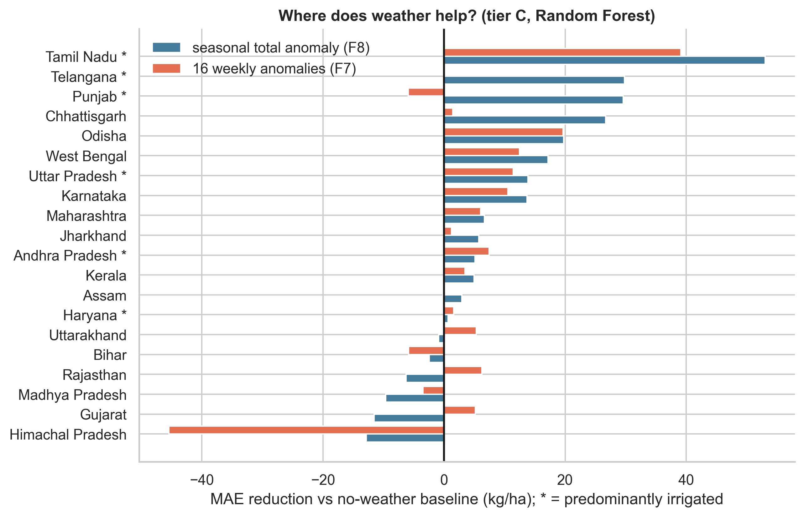
* **Extreme years.** Weather helps in all regimes (dry tail 322.5 → 309.1 with F8 RF, −4.2 %; wet tail 368.0 → 357.0; normal 338.2 → 331.3) with no advantage for lags.
* **Temperature lags as a trend proxy.** Within-district Tmax of the window rises with calendar year (within-district corr 0.39; 97.7 % of districts have a positive slope), whereas rain anomalies show no trend (−0.11). Weekly Tmax/anomaly lags can thus stand in for time, which tier A cannot otherwise see.
  Their tier-A advantage should therefore **not** be read as evidence for timing effects.

### 5.5 Deep sequence models

| Condition | Tier C LSTM | Tier C GRU | Tier A LSTM | Tier A GRU |
|---|---|---|---|---|
| true order (5 seeds) | 329.1 ± 1.6 | 329.6 ± 1.3 | 687.9 ± 6.5 | 679.6 ± 7.7 |
| shuffled weeks (3 seeds) | 327.3 ± 2.7 | 328.3 ± 1.1 | 691.9 ± 5.4 | 697.0 ± 6.5 |
| no weather (3 seeds) | 333.1 ± 0.6 | 333.4 ± 0.6 | 712.9 ± 9.7 | 710.2 ± 12.8 |

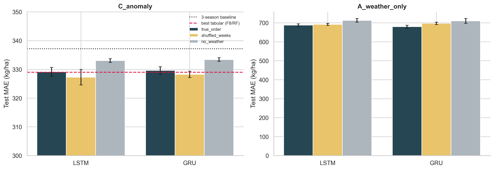

* Weather **does** help the recurrent nets: true order vs no weather −5.0 [-7.1,-2.9] (LSTM) and −5.5 [-7.9,-3.2] (GRU) kg/ha in tier C; −25.8 / −31.1 in tier A.
* But **order does not**: in tier C shuffled weeks are as good or better (true − shuffled +2.3 [+0.8,+3.6] LSTM, +1.2 [-0.4,+2.7] GRU).
* In tier A only, true order beats shuffled for the GRU (−17.8 [-23.5,-12.0]; LSTM −4.0 [-7.9,0.0]) - the sole evidence of order-dependence in the whole study, and in the formulation where weather is confounded with trend (5.4).
* Against tabular models (tier C) the networks are on par: LSTM 329.1 vs RF-F8 329.0 and RF-F1 329.4 kg/ha.

### 5.6 Pre-specified structured lag models (extension E9)

Because 16 free lags are statistically wasteful (Section 6), we tested, before looking at test results, eight low-dimensional representations in tier C (`scripts/22_run_structured_lag_models.py`, notebook 12): smooth distributed lags (Legendre basis of degree 2 and 3, 3-4 parameters), stage-sum anomalies, a deficit/surplus split of the seasonal anomaly, a train-only panel-FE weather index and combinations. Rules: selection on validation MAE only, test scored once, Holm correction over 21 comparisons against the seasonal-total anomaly (F8).

| Test MAE (kg/ha) | Ridge | RF | XGBoost |
|---|---|---|---|
| F5 16 free lags | 334.3 | 332.8 | 338.1 |
| F8 seasonal total anomaly (reference) | 331.1 | 329.0 | 333.7 |
| S1 smooth lag, degree 2 | 330.7 | **327.0** | 330.0 |
| S2 smooth lag, degree 3 | **330.1** | 326.5 | 330.2 |
| S7 stages + deficit/surplus | 329.6 | 327.9 | 331.2 |
| *No-weather baseline* | 337.2 | | |

Validation selected S1 for RF and XGBoost. Paired differences against F8: RF S1 -2.0 [-3.6,-0.4], S2 -2.6 [-4.5,-0.7]; XGBoost S1 -4.1 [-7.2,-1.1], S2 -3.9 [-7.7,-0.1]; Ridge S2 -1.0 [-1.5,-0.6]. After Holm correction only Ridge/S2 remains significant (adjusted p < 0.001); the others have adjusted p ≈ 0.15-0.6.
Under rolling origin (2011-2017) the RF difference is -1.1 [-2.4,+0.2] and XGBoost is null (S1 -0.8 [-3.1,+1.5]), while free lags remain worse than the total (RF +3.6 [+0.9,+6.2]; XGBoost +5.9 [+1.2,+10.1]). The learned panel index and the deficit/surplus split did not help.
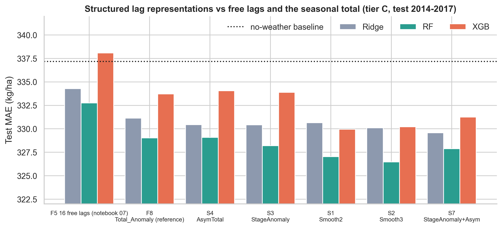

**Reading.** The weak result for free lags is mostly a parametrisation problem: with a smooth, low-dimensional profile the weekly information is no longer harmful and is consistently, though modestly, better than the seasonal total (about 0.6 % of MAE, 3.0 % better than the no-weather baseline against 2.4 % for the total). The gain is within the range one would expect from the 0.5-point extra variance explained by weekly timing (Section 5.7), so it is a coherent but small effect, not a breakthrough.

### 5.7 Explanation: what do the explainers say?

**Panel regression.** (N = 10,279, R² = 0.771.) The 16 weekly effects are jointly non-zero (χ² = 112.4, p = 1.6×10⁻¹⁶) and **unequal** (χ² = 65.2, p = 3.1×10⁻⁸): timing matters in the explanatory sense. Largest effects (% yield per +100 mm in that week): week −1 **+5.0** [2.9,7.1],
−2 +3.3 [1.3,5.2], −7 +3.1 [1.7,4.5], −13 +2.6 [1.5,3.7], −5 +2.2, −8 +2.1, −16 +2.1; weeks −3, −4, −10, −14, −15 are indistinguishable from zero. By stage: grain-filling +5.2 [3.1,7.3], panicle initiation +1.9, flowering +1.4, tillering +1.3, sowing/transplanting +1.1.
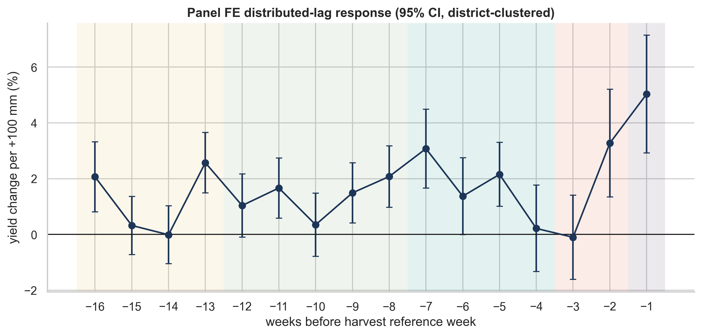

**How much does this explain?** With district and year effects, the seasonal total anomaly accounts for **1.01 %** of the remaining variance and the 16 weekly anomalies for **1.53 %** - a 0.5-point gain that cannot be converted into a sizeable out-of-sample improvement.

**Model explainers.** TreeSHAP (tier C) spreads importance over many weeks without a clear phenological pattern (largest per-week share in sowing/transplanting: 8.1 %/week vs 5.1-6.3 % elsewhere) and its weekly profile has only rank correlation 0.05 with the panel |β| profile
(permutation importance: 0.49 with panel, 0.29 with SHAP; sign agreement 0.31). Jointly permuting the 16 lags raises tier-C MAE by 11.0 ± 1.8 kg/ha (state effects 2.8, Tmax 0.04), confirming that the lag block carries *some* signal although individual weeks are unstable. 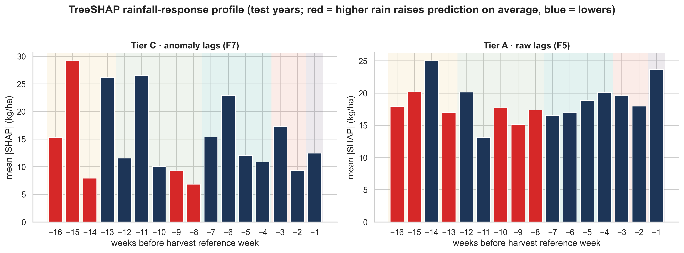
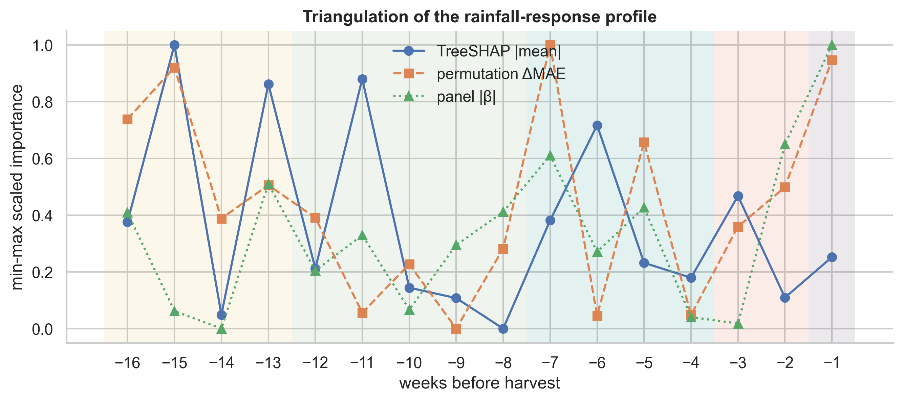

**Seasonal response shape.** The residual yield response to the 16-week rainfall anomaly is **strongly asymmetric**: a rainfall deficit of 200-400 mm below the district normal lowers yield by roughly 8-11 %, whereas surpluses give a plateau of +2-4 % and no further gain beyond about +200 mm. Both irrigated and rain-fed groups reject equal weekly effects (p ≈ 10⁻¹³ and 10⁻⁷) but with different profiles: early-season weeks (−16, −15; sowing/transplanting) dominate in irrigated states (+5.5 and +3.2 % per 100 mm), mid-season and final weeks (−13, −7, −5, −1) in rain-fed/mixed states. 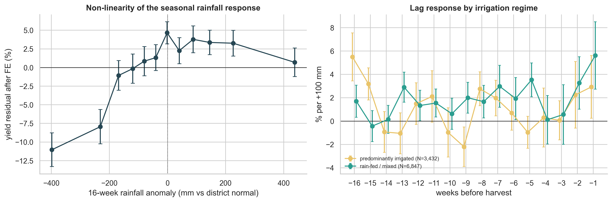

---

## 6. Discussion

**Answering the research questions.**
**RQ1 - Not as 16 free parameters; marginally as a structured profile.** A 16-week free-lag representation does not reduce out-of-sample forecast error relative to a same-source seasonal aggregate; it is typically 1 % worse (tier C) and only in one model-tier cell family (tier B, XGBoost/Ridge) 1-2 % better. Contemporaneous (last-month) rainfall is worse than every other representation; stage sums and cumulative sums sit between.
**RQ2 - the data point to the end of the season.** The explanatory regression puts the largest effects on the last two pre-harvest weeks (grain filling), the panicle-initiation weeks (−7, −5) and early transplanting (−13, −16), with near-zero effects in weeks −3/−4 and −10/−14/−15. These windows are consistent with the phenological table, but they are partly confounded by the zone-wide anchor week: a fixed $T_{ref}$ per state cannot align with year- and district-specific sowing dates.
**RQ3 - the explainers disagree with each other.** The panel profile is statistically structured; the model-based profiles are diffuse and uncorrelated with it. A reader should trust the profile that is accompanied by confidence intervals and rejects a null, not a bar chart of SHAP values from a model whose lags it hardly uses.

**Why are lags no help?** (i) *Signal bound.* After removing district and year effects, all rainfall information (total *and* timing) explains ≈ 1.0-1.5 % of residual yield variance; a forecast cannot gain more than that. (ii) *Estimation cost.* Sixteen noisy, nearly orthogonal predictors cost more variance than they remove when the signal is 0.5 points; the aggregate pools the same information into one well-estimated coefficient.
(iii) *Management buffers weather.* Much of Indian rice is irrigated and yield statistics are administrative estimates; irrigation, varieties and inputs absorb timing effects. (iv) *Calendar misalignment.* A single harvest week per state ignores year-specific monsoon onset and varietal duration (our placebo analysis shows alignment matters, but not at week precision).
(v) *Spatial support.* One 75-km point per district averages across heterogeneous cropped areas.

**Why Phase 1 looked weak.** The 1990-2009 → 2014-2017 shift (+32 % mean yield) dwarfs any weather effect; the Phase 1 baseline predicted at the state mean. Pure weather-plus-state models are structurally unable to follow the trend; the right question is how much weather adds *beyond* a forecast that knows the district's recent level (tier C): +2.4 % in MAE. This reframing is the main conceptual correction relative to the proposal's premise.

**Practical implications.** For operational district forecasting in this setting: (1) the dominant predictor is the district's recent yield history; (2) a single seasonal rainfall anomaly captures most of what weather can add; (3) week-resolved rainfall should be preferred only where a specific, mechanistic question (e.g. grain-filling rain) motivates it, and then via a low-dimensional parametrisation (stage sums or a smooth distributed lag) rather than 16 free parameters.

---

## 7. Threats to validity and limitations

* **Weather representativeness.** One point per district, 0.25° rain / 1° Tmax; QC r = 0.905 with `IMD_RF`, but a few hill and coastal districts remain poor (13 flagged; results unchanged when excluded).
* **Calendar.** Zone-level $T_{ref}$ rather than district/season-specific dates; the dataset has no sowing or harvest dates and does not separate Kharif/Rabi/Summer rice (annual yield).
* **Outcome noise.** Administrative yield estimates (crop-cutting experiments) are noisy; district boundaries changed over 1990-2017 and some names map to successor districts.
* **Irrigation.** No district irrigation data; the irrigated/rain-fed grouping is a coarse external classification, so heterogeneity results are exploratory.
* **Baseline feature caveat.** `IMD_RF` (F0) is a calendar-year aggregate that may include post-harvest rain; it is *more* generous to the baseline than our strictly pre-harvest lags, which makes the "lags don't beat aggregates" conclusion conservative with respect to F0 and is why we added the same-source control F1.
* **Context features.** Tiers B/C use previous-season yields, which are available at forecast time only if the previous season's statistics are published before the new harvest; this is typical but not guaranteed.
* **Multiplicity.** Many comparisons were run; we therefore emphasise consistency across tiers, models, controls and folds rather than any single p-value.
* **Explanation ≠ causation.** The panel regression has a conditional reading under the assumption that rainfall anomalies are as-good-as-random given district and year effects; SHAP and permutation importance describe model behaviour only.
* **Data mining of hyper-parameters** is limited by design (validation-only tuning, test touched once), but the formulation tiers were chosen after piloting on the test period's structure (the +32 % shift was visible in Phase 1 results); the tier-C results should be re-confirmed on future seasons.

---

## 8. Conclusion

**Main research finding.** Rice yield in India responds to *when* rain falls, not only to how much: the weekly rainfall effects are significantly unequal (p = 3x10^-8), concentrated in the last two weeks before harvest (+5.0 % per +100 mm in week -1) and in the panicle-initiation and transplanting weeks, with an asymmetric drought-dominated response (8-11 % loss at 200-400 mm deficits).
This validates the proposal's biological premise and supplies an explicit, uncertainty-quantified map of critical exposure windows.

**Forecasting consequence.** The timing signal is too small to be learned from 16 free weekly predictors: weather explains about 1.0-1.5 % of the variance left after district and year effects, so a seasonal rainfall anomaly captures nearly all forecastable weather information (+2.4 % over a no-weather forecast, +4.2 % in dry-tail years), and order-shuffled lags perform equally.
Phase 1's low accuracy was due to a 32 % yield shift between training and test periods, not to missing timing; a trend-aware forecast reaches R^2 = 0.756.

**Structure is what makes timing usable.** Smooth 3-4-parameter lag profiles recover the skill lost by 16 free lags and slightly improve on the seasonal total (about 0.6 %), a consistent but modest effect that is not robust to Holm correction or rolling origin.

**Contribution and recommendation.** The project delivers a leakage-proof lag dataset, a controlled benchmark, a phenology-anchored rainfall-exposure profile and a decision rule: forecast operationally with recent district yield plus a seasonal rainfall anomaly, and reserve weekly-resolved models for mechanism questions.

**Future work.** Fit the smooth lag profile jointly with district-specific windows and test it on post-2017 seasons; District-specific sowing/harvest dates from remote sensing (e.g. NDVI phenology); polygon-averaged weather with district shapefiles; separate Kharif/Rabi yields; irrigation fractions; soil-moisture or evapotranspiration inputs that integrate rainfall physically; smooth distributed-lag (functional) models; temporal cross-validation over more recent seasons; multi-crop extension for crop-specific lag structure.

---

## 9. Reproducibility

```
python scripts/12_download_imd_grid.py        # IMD grids (needs internet)
python scripts/10_geocode_districts.py ; python scripts/10b_fix_geocoding_aliases.py
python scripts/14_refine_geolocation.py ; python scripts/13_extract_district_weather.py
python scripts/15_build_lag_dataset.py
python scripts/20_run_tabular_experiments.py ; python scripts/21_run_sequence_experiments.py
python scripts/build_nb06_weather.py … build_nb11_synthesis.py   # execute notebooks 06-11
pytest -q                                      # 36 tests
```
Seeds {42, 7, 123, 2024, 99}. Environment: `requirements.txt`. Deterministic except for BLAS/thread effects in PyTorch (differences < 1 kg/ha).

---

## References

* Breiman, L. (2001). Random forests. *Machine Learning*, 45, 5-32.
* Chen, T., & Guestrin, C. (2016). XGBoost: A scalable tree boosting system. *Proc. KDD*.
* Cho, K., et al. (2014). Learning phrase representations using RNN encoder-decoder for statistical machine translation. *Proc. EMNLP*.
* Hochreiter, S., & Schmidhuber, J. (1997). Long short-term memory. *Neural Computation*, 9(8), 1735-1780.
* Jeong, J. H., et al. (2016). Random forests for global and regional crop yield predictions. *PLoS ONE*, 11(6), e0156571.
* Khaki, S., Wang, L., & Archontoulis, S. V. (2020). A CNN-RNN framework for crop yield prediction. *Frontiers in Plant Science*, 10, 1750.
* Lobell, D. B., & Burke, M. B. (2010). On the use of statistical models to predict crop yield responses to climate change. *Agricultural and Forest Meteorology*, 150, 1443-1452.
* Lundberg, S. M., et al. (2020). From local explanations to global understanding with explainable AI for trees. *Nature Machine Intelligence*, 2, 56-67.
* Pai, D. S., et al. (2014). Development of a new high spatial resolution (0.25° × 0.25°) long period (1901-2010) daily gridded rainfall data set over India. *Mausam*, 65(1), 1-18.
* Schlenker, W., & Roberts, M. J. (2009). Nonlinear temperature effects indicate severe damages to U.S. crop yields under climate change. *PNAS*, 106(37), 15594-15598.
* van Klompenburg, T., Kassahun, A., & Catal, C. (2020). Crop yield prediction using machine learning: A systematic literature review. *Computers and Electronics in Agriculture*, 177, 105709.
